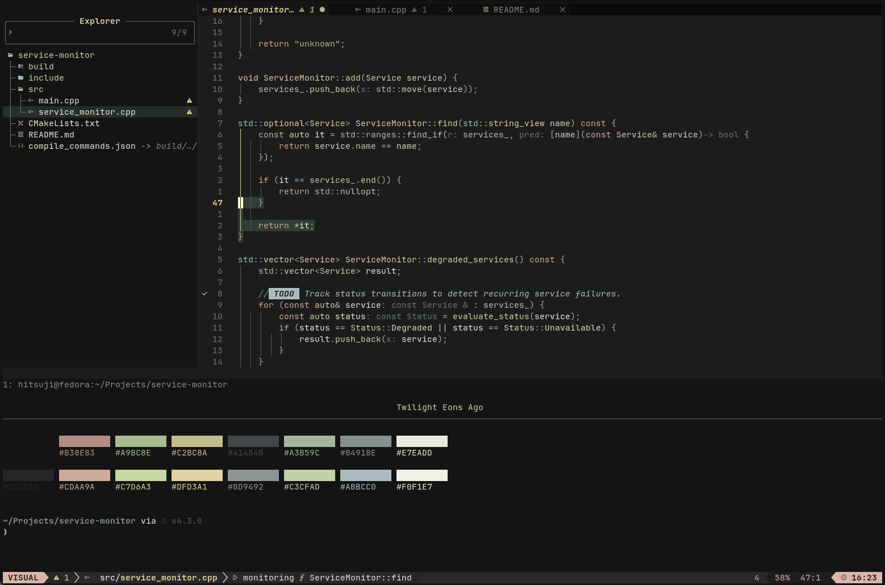

# Twilight Eons Ago

A color theme inspired by GNOME Ptyxis Twilight, designed for a consistent look across editors and desktop applications.

## Supported Applications

- Neovim

### Planned

- Ptyxis (improved version)
- GNOME Text Editor
- Nautilus
- GNOME Shell
- GTK 3/4
- Firefox
- Thunderbird

## Neovim



Currently focused on **C/C++**, with general syntax highlighting for other languages. More detailed support is planned.

### Features

- **Tree-sitter** syntax highlighting
- **LSP** semantic highlighting
- **Diagnostics** and **Git** indicators
- UI colors for **GitSigns**, **Snacks.nvim**, **blink.cmp**, **mini.icons**, **which-key.nvim**, and **lazy.nvim**

## Installation

### Neovim

#### Using LazyVim

Add the following to `~/.config/nvim/lua/plugins/colorscheme.lua`:

```lua
return {
  {
    "Hitsujii/twilight-eons-ago",
    lazy = false,
    priority = 1001,
    init = function(plugin)
      vim.opt.rtp:append(plugin.dir .. "/neovim")
    end,
  },
  {
    "LazyVim/LazyVim",
    opts = {
      colorscheme = "twilight-eons-ago",
    },
  },
}
```

#### Manual Installation

Clone the repository:

```bash
git clone https://github.com/Hitsujii/twilight-eons-ago.git ~/.local/share/nvim/twilight-eons-ago
```

Add the following to `~/.config/nvim/init.lua`:

```lua
vim.opt.rtp:append(vim.fn.stdpath("data") .. "/twilight-eons-ago/neovim")
vim.cmd.colorscheme("twilight-eons-ago")
```

Both methods add the `neovim/` directory to `runtimepath`, allowing Neovim to find the colorscheme within the multi-application repository.

## Credits

Loosely inspired by [GNOME Ptyxis Twilight](https://sources.debian.org/src/ptyxis/51.1-1/src/palettes/Twilight.palette/).
